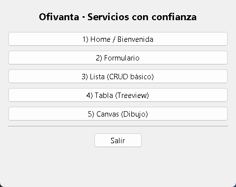
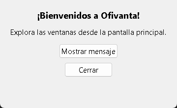
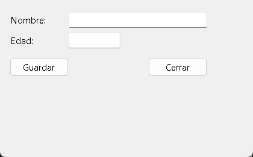
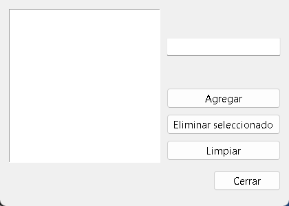
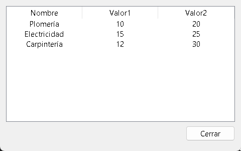
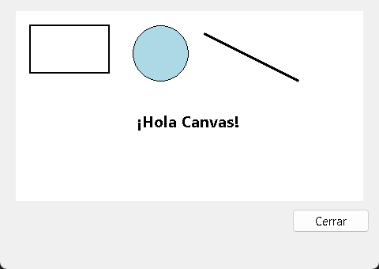

Sesión 3. Base de Ofivanta

Equipo Ofivanta
ODS 8: Trabajo Decente y Crecimiento Económico
10 de noviembre de 2026

En esta sesión se preparó la base del proyecto con un menú y cinco ventanas en tkinter. La idea era tener una parte para cada integrante y después adaptarla a una aplicación de servicios para el hogar.

Este documento muestra cómo era esa primera versión. Las funciones actuales están en [Cambios en la aplicación](07_interfaz_y_modelo_ingresos.md).

Para abrir el proyecto, se necesita Python con tkinter. Desde la carpeta del repositorio se ejecuta:

```text
python -m src.app.main
```

También se incluyó una configuración de VS Code para ejecutarlo con F5. No se necesitan paquetes adicionales.

main.py abre el menú y conecta los cinco archivos de src/app. Los datos de ejemplo están en data y las capturas en docs/capturas.

Así funcionaban las ventanas de la base:

1. win_home.py mostraba la bienvenida y un mensaje sobre el proyecto.
2. win_form.py pedía nombre y edad, revisaba los campos y permitía guardarlos en un archivo de texto.
3. win_list.py permitía agregar texto a una lista, eliminar una selección o limpiar todo. La lista no se guardaba al cerrar.
4. win_table.py leía data/sample.csv y mostraba sus tres registros en una tabla.
5. win_canvas.py dibujaba un rectángulo, un óvalo, una línea y un texto.

Los registros del CSV eran ejemplos de plomería, electricidad y carpintería. Sus cantidades eran ficticias y no representaban salarios ni calificaciones.

La distribución del equipo fue:

Laira Fernanda Barroso Villa: bienvenida, src/app/win_home.py.

Irma Gloria Núñez Romo: formulario, src/app/win_form.py.

Gonzalo Martínez Zermeño: lista, src/app/win_list.py.

Leonardo Alfaro García: tabla y CSV, src/app/win_table.py y data/sample.csv.

Jorge Fernando Villalobos García: dibujo, src/app/win_canvas.py.

Luis Ernesto Guerrero García: integración, pruebas y documentación.

Las capturas de esa versión son:













En esa revisión pasaron seis pruebas. Se comprobaron los botones, la validación y el guardado del formulario, las operaciones de la lista, la lectura del CSV y las figuras. Las ventanas se abrieron para tomar las capturas; F5 no se probó desde VS Code en esa revisión.

Si aparece un error al abrirlo, primero hay que comprobar que la terminal esté en la carpeta del proyecto y que Python tenga tkinter. Para la tabla también debe existir data/sample.csv.

La entrega de esta sesión es el enlace al repositorio con el código, la configuración y estas capturas.
