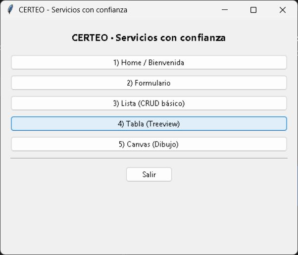
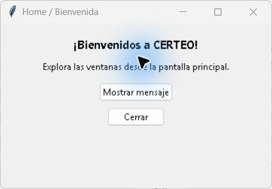
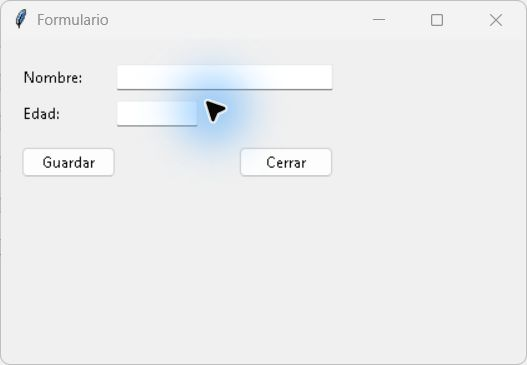
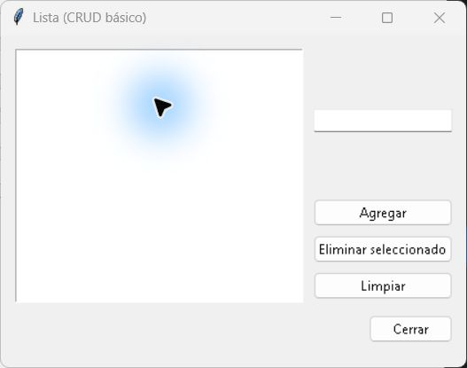
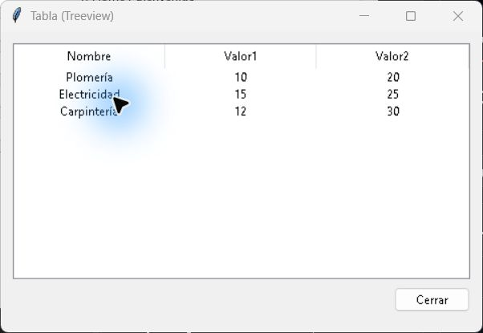
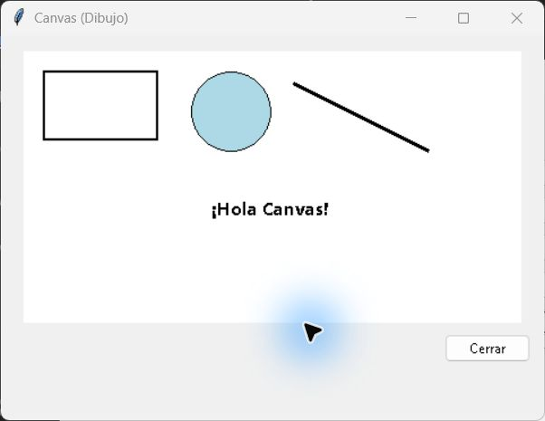

# Sesión 3 — Esqueleto de CERTEO con cinco ventanas tkinter

**Proyecto:** CERTEO — Servicios con confianza.  
**ODS:** 8, Trabajo Decente y Crecimiento Económico.  
**Fecha:** 10 de noviembre de 2026.

## Objetivo y alcance

Construir una estructura modular en Python con una ventana principal y cinco
subventanas integradas. El proyecto retoma la idea de conectar clientes con
profesionales de oficios. En esta sesión se demuestra la interfaz mínima:
bienvenida, captura de datos, lista de servicios, tabla CSV y dibujo.
Los registros son ficticios. Todavía no hay autenticación, verificación de
identidad, reputación, conexión a Internet ni base de datos.

## Estructura

```text
.vscode/
  launch.json
data/
  sample.csv
docs/
  04_skeleton_5_ventanas_tkinter_equipo.md
  capturas/
    01_principal.png
    02_home.png
    03_formulario.png
    04_lista.png
    05_tabla.png
    06_canvas.png
src/
  __init__.py
  app/
    __init__.py
    main.py
    win_home.py
    win_form.py
    win_list.py
    win_table.py
    win_canvas.py
  core/
    __init__.py
tests/
  test_app.py
.gitignore
README.md
```

`core` queda reservado para utilidades compartidas futuras; no se requiere
`helpers.py` en este esqueleto. Los archivos `__init__.py` definen paquetes.

## Instalación y ejecución

1. Clonar `https://github.com/a00228052-create/ODS8_BolsaDeTrabajo` y abrir la
   carpeta raíz en VS Code.
2. Instalar Python para Windows con tkinter. Comprobarlo con `python -m tkinter`.
3. Crear el entorno virtual desde la raíz:

   ```powershell
   python -m venv .venv
   ```

4. Instalar en VS Code las extensiones Python, Pylance y Python Debugger de Microsoft.
5. Usar **Python: Select Interpreter** y seleccionar `.venv\Scripts\python.exe`.
6. En **Run and Debug**, elegir **Ejecutar CERTEO (src.app.main)** y presionar F5.

También se puede ejecutar sin activar el entorno en PowerShell:

```powershell
.\.venv\Scripts\python.exe -m src.app.main
```

`launch.json` usa `module: src.app.main`, `cwd: ${workspaceFolder}` y el tipo
`debugpy`. Los imports relativos resuelven los módulos del mismo paquete sin
modificar `PYTHONPATH`. Se debe ejecutar desde la raíz, como módulo, y no abrir
`main.py` como un script independiente. No hay dependencias de pip.

## Explicación del código

### `src/app/main.py`: ventana principal

Importa las cinco funciones `open_win_*`. `main()` crea una sola instancia
`tk.Tk`, establece el título y tamaño y coloca un `ttk.Frame` con botones.
Cada botón llama a una función mediante `lambda`, pasando `root` como padre.
`root.mainloop()` procesa los eventos; **Salir** ejecuta `root.destroy()`.
La condición `if __name__ == "__main__"` inicia la aplicación al ejecutarla
como módulo. Las ventanas hijas usan `Toplevel`, por lo que no crean otros
bucles principales.

### `src/app/win_home.py`: bienvenida

`open_win_home(parent)` construye un `Toplevel` con `Label` y `Button`.
**Mostrar mensaje** abre un `messagebox.showinfo` con la propuesta de CERTEO
y su relación con el ODS 8. **Cerrar** destruye únicamente la subventana.

### `src/app/win_form.py`: formulario

Dos `ttk.Entry` capturan nombre y edad. `validar_y_guardar()` elimina espacios
externos mediante `strip()`, exige un nombre no vacío y comprueba con
`isdigit()` que la edad contenga dígitos. No representa una verificación legal
de edad. Los datos siguen siendo cadenas de texto.

Si la validación pasa, `asksaveasfilename` solicita el destino `.txt`.
Cancelar no guarda nada. El archivo se escribe con `with open` y UTF-8;
un `try/except OSError` informa si falla la escritura. Un mensaje confirma
el guardado. Se usa `grid` para alinear etiquetas y campos dentro del frame.

### `src/app/win_list.py`: lista de servicios

Un `tk.Listbox` almacena elementos durante la sesión. **Agregar** toma el
texto del Entry, rechaza cadenas vacías, inserta al final y limpia el campo.
**Eliminar seleccionado** obtiene el índice con `curselection()` y elimina
el elemento seleccionado. **Limpiar** elimina todos los elementos.
Estas operaciones cubren lo pedido en la consigna; no incluyen edición ni
persistencia de la lista. `rowconfigure` y `columnconfigure` permiten expandirla.

### `src/app/win_table.py`: tabla CSV

`ttk.Treeview` presenta tres columnas: `nombre`, `valor1` y `valor2`.
`csv.DictReader` interpreta la primera fila del CSV como encabezados y cada
fila posterior como un diccionario. `tv.insert` agrega los valores a la tabla.
La ruta se obtiene con `Path(__file__).resolve().parents[2] / "data" /
"sample.csv"`, que apunta a `data` en la raíz del repositorio. La lectura
usa UTF-8 para conservar los acentos. Si el archivo no existe, se muestra
un aviso y el botón de cierre sigue disponible.

### `data/sample.csv`: datos de ejemplo

Contiene tres oficios: Plomería, Electricidad y Carpintería. `valor1` y `valor2`
son cantidades ficticias sin unidades, conservadas del formato de la
plantilla; no deben interpretarse como estadísticas, salarios o calificaciones.

### `src/app/win_canvas.py`: dibujo

Un `tk.Canvas` blanco contiene un rectángulo, un óvalo con relleno azul,
una línea y un texto. `create_rectangle`, `create_oval`, `create_line` y
`create_text` reciben coordenadas en píxeles desde la esquina superior izquierda.
Demuestra objetos gráficos básicos, sin herramientas de dibujo interactivo.

### Configuración y pruebas

`.vscode/launch.json` inicia la misma entrada modular que la terminal.
`.gitignore` excluye `.venv`, cachés y bytecode. `tests/test_app.py` verifica
los widgets y sus acciones con `unittest`; los diálogos se sustituyen durante
las pruebas y el archivo de prueba se guarda en una carpeta temporal.

## Primer Happy Path

1. Iniciar CERTEO y ver los cinco accesos del menú.
2. Abrir Bienvenida, mostrar el mensaje y cerrar la subventana.
3. Abrir Formulario, escribir un nombre y una edad numérica, pulsar Guardar,
   elegir un `.txt` y recibir la confirmación.
4. Abrir Lista, agregar un servicio, seleccionarlo y eliminarlo; agregar otros
   y usar Limpiar.
5. Abrir Tabla y comprobar los tres registros del CSV.
6. Abrir Canvas y observar las cuatro figuras.
7. Cerrar las subventanas y salir desde el menú principal.

## Evidencias de ejecución

Capturas reales de la aplicación ejecutada en Windows:

### Ventana principal



### Ventana 1 — Bienvenida



### Ventana 2 — Formulario



### Ventana 3 — Lista



### Ventana 4 — Tabla



### Ventana 5 — Canvas



## Verificación

Se ejecutó `python -m unittest discover -s tests -v` con Python 3.14.7 en
Windows: **6 pruebas aprobadas**. Se comprobaron navegación y cierre de las
cinco ventanas, mensaje de bienvenida, errores de nombre/edad, cancelación y
guardado del formulario, agregar/eliminar/limpiar, lectura de las tres filas
del CSV y los cuatro objetos gráficos. También se verificó la compilación
de los módulos con `compileall` y se abrieron las seis ventanas para las capturas.
La configuración de VS Code está incluida; la sesión F5 no se ejecutó desde
VS Code durante esta revisión.

## Solución de problemas

- **Imports:** ejecutar `python -m src.app.main` desde la raíz del proyecto.
- **tkinter ausente:** reparar la instalación oficial de Python agregando Tcl/Tk.
- **CSV ausente:** conservar `data/sample.csv` y sus tres encabezados.
- **Intérprete incorrecto:** seleccionar el Python de `.venv` en VS Code.
- **Guardado fallido:** elegir una carpeta con permisos de escritura.

## Entrega

El entregable de Canvas es el enlace del repositorio con el código,
la configuración y este documento junto con las imágenes en `docs/capturas`.

## Roles y distribución de responsabilidades

Distribución asignada para esta entrega. Describe responsabilidades del equipo;
no constituye un registro de autoría individual ni de contribuciones históricas.

| Integrante | Responsabilidad asignada | Archivo o evidencia |
| --- | --- | --- |
| Laira Fernanda Barroso Villa | Ventana 1: bienvenida y mensaje | `src/app/win_home.py` |
| Irma Gloria Núñez Romo | Ventana 2: formulario, validación y guardado | `src/app/win_form.py` |
| Gonzalo Martínez Zermeño | Ventana 3: lista y operaciones básicas | `src/app/win_list.py` |
| Leonardo Alfaro García | Ventana 4: tabla y datos CSV | `src/app/win_table.py`, `data/sample.csv` |
| Jorge Fernando Villalobos García | Ventana 5: dibujo Canvas | `src/app/win_canvas.py` |
| Luis Ernesto Guerrero García | Integración, depuración, pruebas y documentación | `main.py`, `launch.json`, `tests/`, `docs/` |

El equipo tiene seis integrantes; se conserva una persona por subventana y
se asigna la integración y documentación al sexto integrante.
