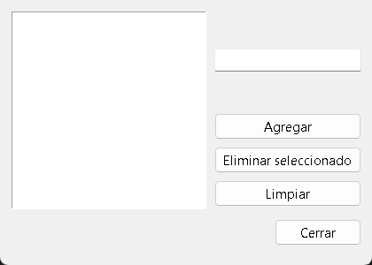
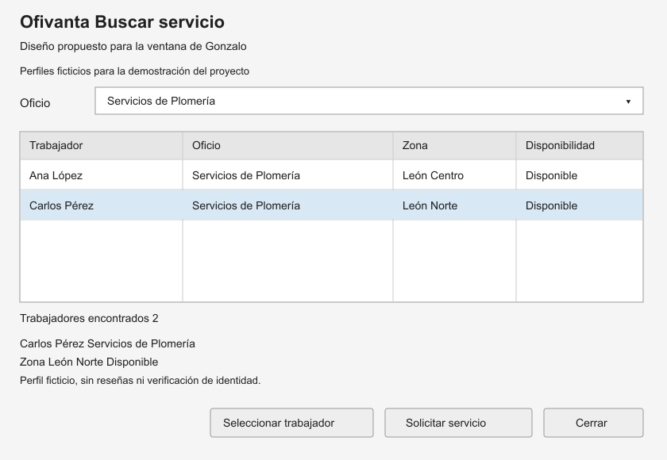
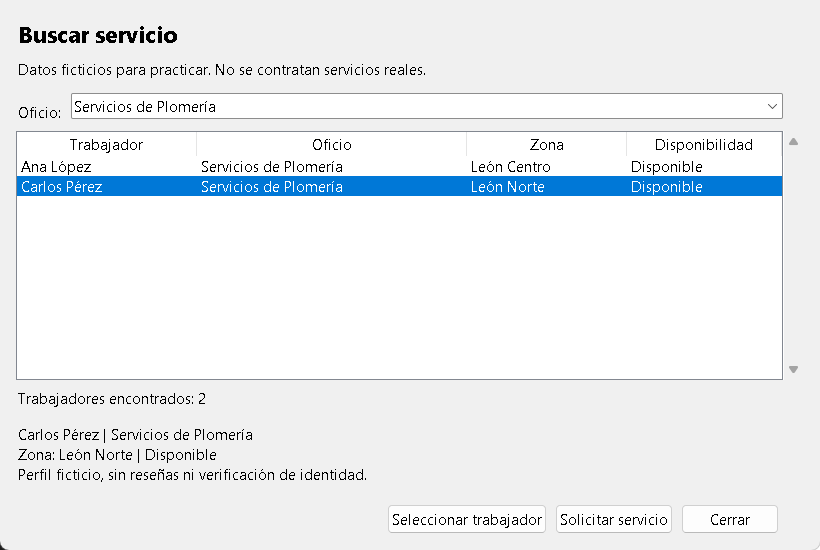

Sesión 5. Buscar servicio

Gonzalo Martínez Zermeño
Equipo Ofivanta
Ventana asignada: src/app/win_list.py
17 de noviembre de 2026

Esta parte de Ofivanta sirve para buscar un oficio y elegir a un trabajador. Por ejemplo, si alguien tiene una fuga, puede buscar plomería y revisar quién ofrece ese servicio. La idea se relaciona con el ODS 8 porque busca dar más oportunidades de trabajo a las personas que ofrecen oficios.

La ventana original tenía una lista vacía donde se podía agregar o borrar texto. Esta captura muestra el código de la sesión 3 ejecutado para compararlo:

El diseño propuesto coloca el filtro arriba, los trabajadores en el centro y los botones abajo.

Los cambios de esta sesión fueron:

1. Cambiar el título a Buscar servicio.
2. Cargar oficios y trabajadores desde obtener_servicios() y obtener_trabajadores().
3. Mostrar nombre, oficio, zona y disponibilidad en una tabla.
4. Filtrar por oficio y mostrar los datos del trabajador seleccionado.
5. Quitar los botones para agregar o borrar trabajadores del catálogo.
6. Agregar Seleccionar trabajador y Solicitar servicio, con avisos si no hay selección o la persona no está disponible.
7. Pasar el servicio y el trabajador elegidos al formulario de Irma.
8. Conectar la ventana con el menú principal.

En esta prueba se eligió Plomería y a Carlos Pérez. Los perfiles son ficticios.

La ventana se probó desde el menú principal. El proyecto se abre con python -m src.app.main.

El formulario recibió el oficio y el trabajador correctos. También se revisaron los avisos y el cierre de la ventana. Pasaron las nueve pruebas de esa parte.

En esa sesión todavía estaban pendientes el guardado compartido y un error en la ventana de tabla. El avance actual está explicado en [Cambios en la aplicación](07_interfaz_y_modelo_ingresos.md).

Estos cambios ayudan a que el cliente encuentre opciones antes de pedir un servicio. Ver la zona y la disponibilidad facilita la elección, y pasar esos datos al formulario evita escribirlos otra vez.
