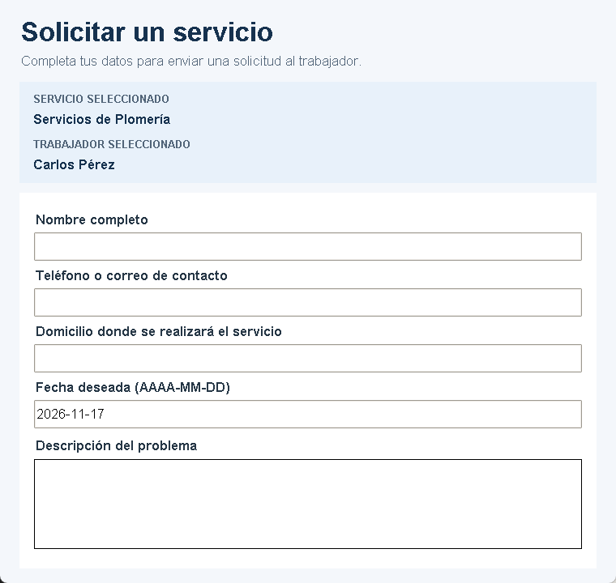

Sesión 5. Adaptación de mi ventana

Gonzalo Martínez Zermeño

Equipo Ofivanta

Ventana 3: src/app/win_list.py

17 de noviembre de 2026

Mi parte en Ofivanta es la ventana donde el cliente busca un oficio y elige a un trabajador. Por ejemplo, si tiene una fuga en su casa, puede buscar plomería y revisar quién ofrece ese servicio. Esto va con la idea del proyecto de ayudar a los trabajadores de oficios a encontrar clientes y se relaciona con el ODS 8.

La ventana original solo tenía una lista vacía y botones para agregar o borrar texto. Esta es una captura del código de la sesión 3, ejecutado otra vez para hacer la comparación:

La idea para mi diseño fue poner el filtro de oficios arriba, los trabajadores en el centro y los botones abajo. Así se puede revisar la información antes de pasar al formulario. Este es el boceto:

Los cambios al código base fueron:

1. Cambiar el nombre a Buscar servicio y hacer más grande la ventana.
2. Cargar los oficios y trabajadores desde obtener_servicios() y obtener_trabajadores(), en los archivos compartidos de src/core.
3. Cambiar la lista por una tabla que muestre nombre, oficio, zona y disponibilidad.
4. Agregar un filtro por oficio y mostrar los datos del trabajador al seleccionar una fila.
5. Quitar Agregar, Eliminar y Limpiar, porque el cliente no debe cambiar el catálogo.
6. Poner Seleccionar trabajador y Solicitar servicio. Si no se elige a nadie o el trabajador no está disponible, aparece un aviso.
7. Abrir el formulario de Irma con el servicio y el trabajador elegidos, incluyendo sus identificadores.
8. Mantener Cerrar y conectar la ventana con el menú principal.

Así quedó la ventana. En el ejemplo se eligió Plomería y se seleccionó a Carlos Pérez. Debajo de la tabla aparecen sus datos. Todos los trabajadores son ficticios para poder probar la aplicación.

La prueba se hizo desde el botón 3) Buscar servicio del menú principal. La aplicación se inicia desde la carpeta del proyecto con python -m src.app.main.

Después se eligió un oficio, se seleccionó un trabajador y se abrió el formulario. El oficio y el nombre llegaron correctamente:

También se revisaron los avisos al continuar sin selección, el bloqueo de trabajadores no disponibles y que cerrar la lista no cierre el menú. Las nueve pruebas de esta parte pasaron.

Para poder abrir el menú hubo que ajustar main.py, porque la ventana de la tabla tiene un error de indentación. Ahora esa ventana se carga al pulsar su botón y muestra un aviso si todavía falla. La tabla sigue pendiente del equipo. También falta conectar el guardado con Luis; en las pruebas se usó un guardado de ejemplo, no una contratación real.

Con estos cambios la lista ya tiene una función dentro del proyecto. El cliente puede buscar lo que necesita y ver las opciones antes de pedir el servicio. Mostrar la zona y la disponibilidad ayuda a elegir, y enviar esos datos al formulario evita escribirlos otra vez. Todavía faltan partes de la aplicación, pero esta ventana ya permite empezar el recorrido para solicitar un trabajo en casa.
