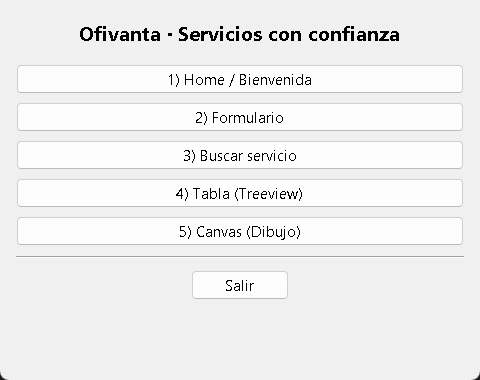

# Sesión 5 — Mi ventana de Ofivanta

Nombre: Gonzalo Martínez Zermeño.

Equipo y proyecto: Ofivanta.

Ventana asignada: Ventana 3, `src/app/win_list.py`.

Fecha: 17 de noviembre de 2026.

## Qué hace mi ventana

En Ofivanta queremos que una persona pueda buscar a alguien que le ayude con un trabajo en su casa, como reparar una fuga o revisar una instalación eléctrica. A mí me toca la pantalla donde se buscan los servicios y se elige al trabajador.

La idea se relaciona con el ODS 8 porque busca ayudar a los trabajadores de oficios a mostrar sus servicios y encontrar clientes. Por ahora usamos datos de ejemplo, así que los perfiles no son personas que se puedan contratar desde la aplicación.

## Cómo estaba antes

La ventana de la sesión 3 tenía una lista vacía y un espacio para escribir. Sus botones eran Agregar, Eliminar seleccionado, Limpiar y Cerrar. Servía para practicar con una lista, pero todavía no mostraba servicios ni trabajadores.

Para tener la comparación, se volvió a ejecutar la ventana original de la sesión 3 y se tomó esta captura. El código original corresponde al commit `f79d110b7edc19094ed1f66e40470b099741956e`.


## Cómo quiero que quede

La pantalla se llama Buscar servicio. Arriba lleva el filtro de oficios; en medio, la tabla de trabajadores; y abajo, los datos de la persona seleccionada y los botones para continuar.

La tabla muestra nombre, oficio, zona y disponibilidad. El diseño es sencillo: fondo claro, letras oscuras y una fila resaltada para saber qué trabajador se eligió. La ventana se puede ampliar si hace falta espacio.

Este es el boceto de la distribución, separado de las capturas de la aplicación funcionando:


También se incluye el [boceto en SVG](capturas/05_gonzalo_diseno_propuesto.svg).

## Cambios al código base

1. Cambiar el nombre y ampliar la ventana para que los datos se vean completos.
2. Cargar los oficios desde `obtener_servicios()` y los trabajadores desde `obtener_trabajadores()`.
3. Cambiar la lista vacía por una tabla con nombre, oficio, zona y disponibilidad.
4. Agregar un filtro para buscar por oficio o ver todas las opciones.
5. Mostrar los datos del trabajador al seleccionar una fila y contar los resultados del filtro.
6. Quitar Agregar, Eliminar seleccionado y Limpiar, porque el cliente no debe modificar a los trabajadores del catálogo.
7. Agregar Seleccionar trabajador y Solicitar servicio. Si no hay una fila seleccionada, mostrar un aviso.
8. No permitir continuar con un trabajador marcado como No disponible.
9. Al pedir un servicio, abrir el formulario de Irma con el oficio y el trabajador elegidos, incluidos sus identificadores.
10. Mantener el botón Cerrar y abrir mi ventana desde el menú principal.

El código también permite recibir un oficio desde la pantalla de inicio. Por ejemplo, puede abrir directamente el catálogo de plomería.

## Cómo quedó

En esta captura se eligió Plomería. Aparecen dos trabajadores y está seleccionado Carlos Pérez. Sus datos se muestran debajo de la tabla.


Los datos están separados de la ventana para que después el equipo pueda cambiarlos sin rehacer toda la interfaz.

| Archivo | Qué contiene |
| --- | --- |
| `src/app/win_list.py` | Mi ventana, el filtro y la selección del trabajador. |
| `src/core/servicios.py` | Los ocho oficios de ejemplo. |
| `src/core/trabajadores.py` | Los diez trabajadores ficticios. |
| `src/app/main.py` | El menú desde donde se abre mi ventana. |
| `tests/test_buscar_servicio.py` | Las pruebas de esta parte. |

## Prueba desde el menú principal

Se trabajó sobre una copia local del proyecto. Para iniciar la aplicación desde su carpeta principal se usa:

```powershell
python -m src.app.main
```

La ventana se probó activando el botón 3) Buscar servicio del menú principal.



El recorrido de prueba fue elegir Plomería, seleccionar a Carlos Pérez y pulsar Solicitar servicio. El formulario recibió la selección correcta, como se ve aquí:


También se comprobó que aparezca un aviso al continuar sin elegir a nadie, que no se pueda solicitar a un trabajador no disponible y que cerrar la lista deje abierto el menú.

Se aprobaron nueve pruebas automatizadas. Revisan los filtros, la selección, los avisos, los datos enviados al formulario y la apertura desde el menú. Se pueden repetir con:

```powershell
python -m unittest discover -s tests -p test_buscar_servicio.py -v
```

Para comprobar los datos que recibe el formulario se usó una función de guardado de prueba. Todavía no se guarda una contratación real.

## Qué queda pendiente

Al revisar el proyecto se encontró un error de indentación en `win_table.py` que impedía iniciar el menú. Se ajustó `main.py` para que esa ventana se cargue solo al abrirla. Si aún falla, aparece un aviso y se puede seguir usando la lista. La tabla sigue pendiente del equipo; esto no significa que las cinco ventanas ya estén terminadas.

Mi parte entrega la selección al formulario actual de Irma. Falta conectar el guardado compartido con Luis y terminar la integración de las demás ventanas. Los perfiles siguen siendo ficticios, sin pagos, reseñas ni verificación de identidad.

## Reflexión

Estos cambios ayudan a que la ventana tenga sentido dentro de Ofivanta. Antes solo permitía escribir y borrar textos. Ahora permite buscar un oficio, comparar las opciones y elegir un trabajador antes de llenar la solicitud.

Mostrar la zona y la disponibilidad ayuda a decidir, y pasar la selección al formulario evita tener que escribir otra vez los mismos datos. Todavía falta integrar otras partes, pero esta ventana ya representa el primer paso para pedir un servicio desde la aplicación.
