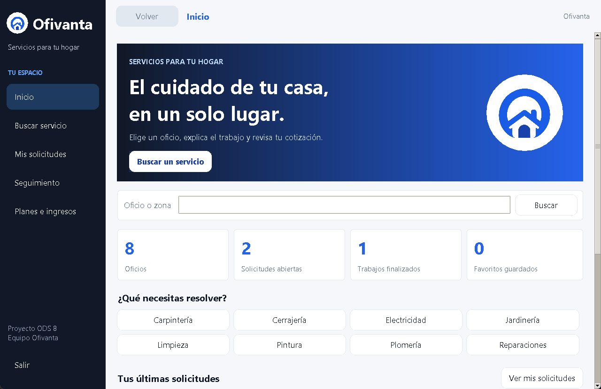
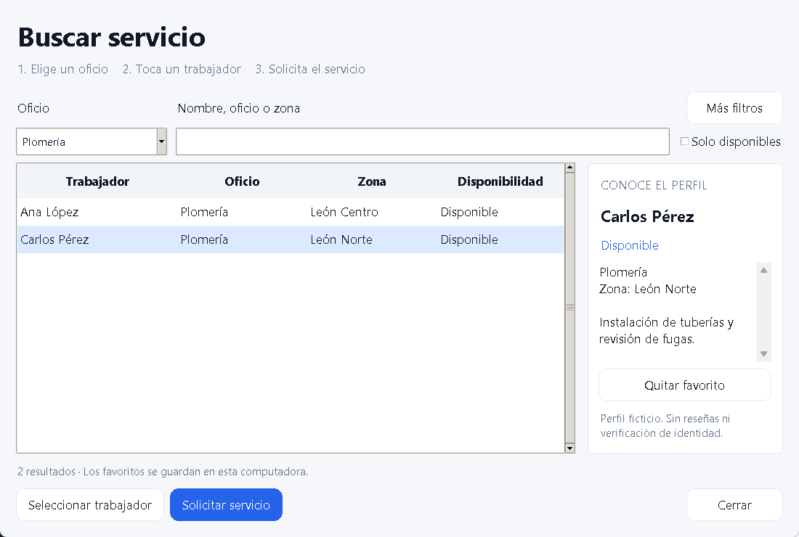
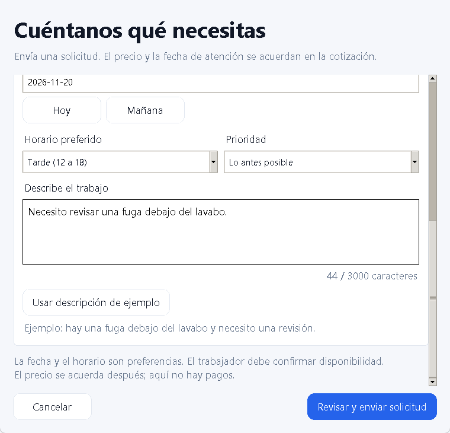
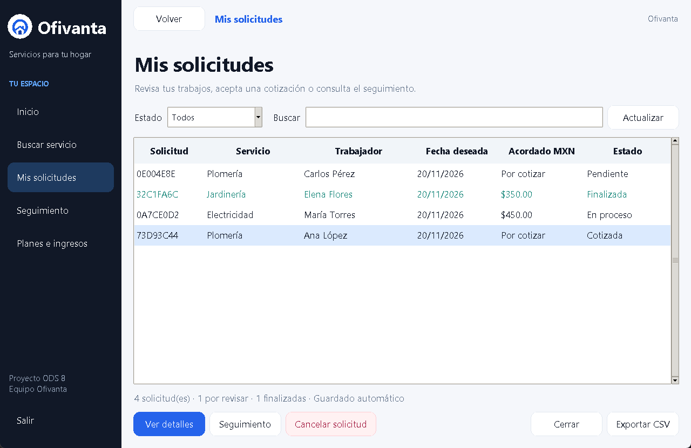
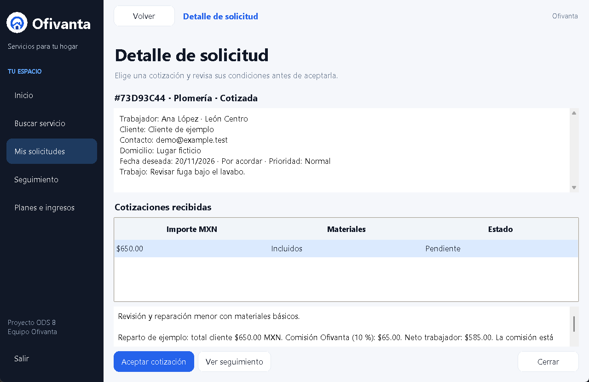
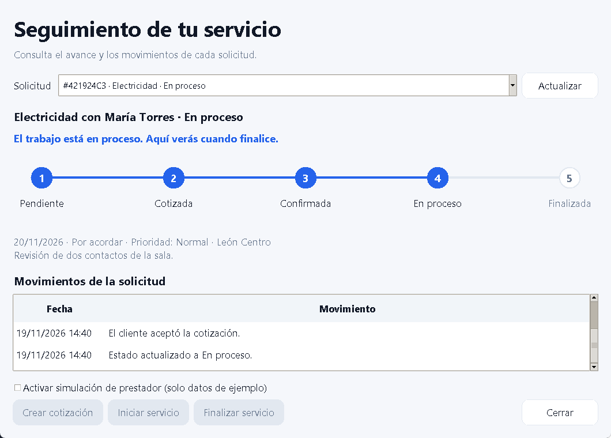

Ofivanta. Cambios en la aplicación

19 de noviembre de 2026

La idea de Ofivanta es que una persona encuentre ayuda para un trabajo en su casa. Puede buscar un oficio, elegir a un trabajador y explicar lo que necesita antes de revisar una cotización.

Se mantuvieron main.py y las cinco ventanas del profesor. El inicio tiene el logo de una casa dentro de una O, un fondo azul con degradado y botones redondeados.

Antes se abrían varias ventanas y se amontonaban. Ahora todo aparece en la ventana principal. El menú queda visible y Volver permite regresar sin perder los filtros o lo que se estaba escribiendo. Si ya hay un formulario empezado y se elige otro trabajador, aparece una pregunta antes de cambiarlo.

En Buscar servicio se puede filtrar por oficio, nombre, zona y disponibilidad. Al seleccionar a alguien aparecen sus datos. También se pueden guardar favoritos.

El formulario recibe al trabajador elegido. Pide nombre, contacto, domicilio, fecha y una descripción del trabajo. La fecha y el horario son preferencias que después debe confirmar el trabajador.

Después de enviar, la solicitud aparece en Mis solicitudes. Desde ahí se consultan los detalles y se acepta una cotización. En Seguimiento se ve si está pendiente, cotizada, confirmada, en proceso o finalizada. También se puede cancelar antes de iniciar el trabajo.

Para generar ingresos se propone una comisión por trabajo terminado y un plan opcional para trabajadores. Básico cobra el 10 % sin mensualidad. Pro cobra el 7 % en nuevas cotizaciones y $149 por 30 días. Incluye agenda y resumen de ganancias. El porcentaje se guarda en cada cotización para que cambiar de plan no modifique lo que ya se ofreció.

Por ejemplo, con 20 trabajos de $500, Básico dejaría $9,000 después de la comisión. Pro dejaría $9,151 después de la comisión y la cuota. La calculadora permite comparar otros casos. Estas cantidades no descuentan materiales, impuestos ni otros gastos.

El apartado de ingresos suma las comisiones de trabajos finalizados y las cuotas Pro de la demostración.

Pasaron 53 pruebas. Se revisaron el guardado, las cotizaciones, los planes y la navegación. También se abrieron las pantallas para comprobar su diseño. Las capturas usan datos de ejemplo separados de los datos de uso de la app.

Esta versión funciona de forma local, con perfiles ficticios y sin cobros. Para ofrecer el servicio a personas reales todavía hacen falta cuentas, un servidor compartido y un sistema de pagos.
