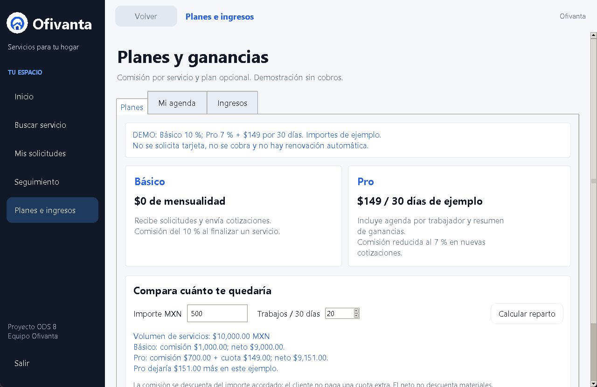
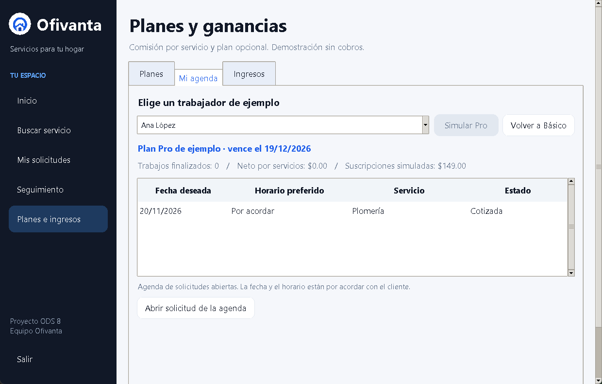
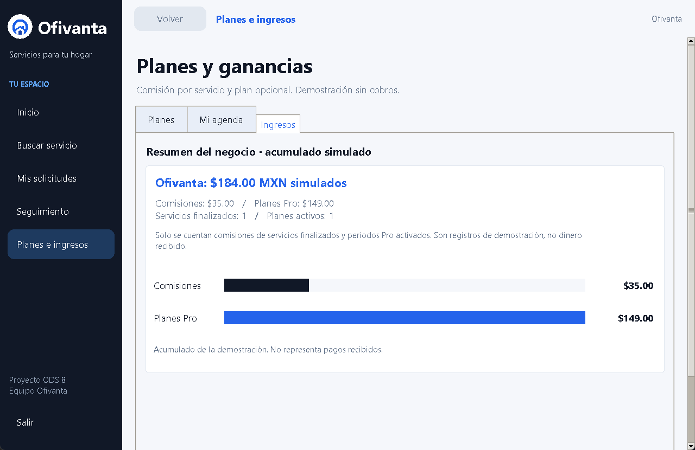

Ofivanta. Interfaz y modelo de ingresos

19 de noviembre de 2026

Se mantuvo la estructura del profesor: main.py, las cinco ventanas de src/app, los datos en src/core y las evidencias en docs. El menú Ir a permite abrir Inicio, Solicitar servicio, Buscar servicio, Mis solicitudes y Seguimiento. Las funciones nuevas se repartieron dentro de esos archivos.

El inicio ahora usa azul intenso, azul claro, blanco y texto oscuro. Tiene un logo propio, un degradado azul y botones redondeados. El botón principal lleva a la búsqueda de servicios. Los contadores muestran datos de la base local.

En la búsqueda se muestran primero los controles necesarios: oficio, búsqueda y disponibilidad. Los favoritos y el orden están en Más filtros. Al tocar un trabajador se ve su perfil; Solicitar servicio abre el formulario con esa persona. Los favoritos se guardan en esta computadora.

El formulario permite elegir Hoy o Mañana, un horario preferido y la prioridad. También tiene una descripción de ejemplo que se puede editar y un contador de caracteres. Después de enviar desde el catálogo se abre el historial con la solicitud seleccionada. La fecha y el horario siguen siendo preferencias que debe confirmar el trabajador.

El modelo de ingresos combina comisión y suscripción. Básico no tiene mensualidad y usa una comisión del 10 %. Pro registra una cuota de ejemplo de $149 por 30 días y reduce la comisión al 7 % en nuevas cotizaciones. También habilita la agenda y el resumen por trabajador. El cliente no paga una comisión adicional sobre el importe acordado.

La calculadora compara lo que le quedaría al trabajador con ambos planes. Por ejemplo, con 20 trabajos de $500, el volumen sería $10,000. Básico descontaría $1,000 de comisión y dejaría $9,000. Pro descontaría $700 de comisión y $149 de cuota, dejando $9,151. Con pocos trabajos puede convenir el plan Básico; la calculadora también muestra ese caso. El cálculo no descuenta materiales, impuestos u otros gastos del trabajador.

El porcentaje se guarda en la cotización para que una activación, cancelación o vencimiento de Pro no cambie lo que ya se ofreció. Reactivar el mismo periodo no registra otra cuota. Al vencer el periodo no se renueva solo.

La agenda de Pro muestra las solicitudes abiertas del trabajador elegido. Los datos y perfiles son ficticios y no hay cuentas reales de prestadores en esta versión.

El resumen de ingresos cuenta comisiones solo de servicios finalizados y las cuotas de periodos Pro activados en la demostración. No suma solicitudes pendientes o canceladas como si fueran dinero recibido.

Se comprobaron 45 pruebas de datos y ventanas. Se revisó el acceso a las cinco ventanas desde el menú, el guardado, los favoritos, los planes, las comisiones y la selección después de enviar. También se revisaron las ventanas en ejecución y se corrigieron las esquinas blancas que aparecían al redondear los botones.

Las capturas usan una base temporal con datos de ejemplo, separada de los datos de uso de la app. Esta versión sigue siendo un prototipo local. Para contratar y cobrar de verdad faltan cuentas, permisos, un servidor compartido y una integración de pagos.

El logo se generó con la herramienta integrada de imágenes. El archivo utilizado está en assets/ofivanta_logo_azul.png; las instrucciones de creación y cambio de color están en assets/como_se_creo_el_logo.txt.
